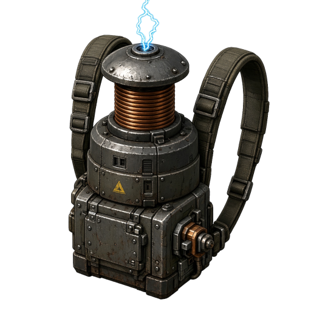

# WePlay: Personal Tesla Defense Equipment

A Factorio mod that adds **Tesla Defense Equipment**: a 2×2 armor module that automatically zaps nearby enemies with chain lightning. It works like personal laser defense, but each shot arcs from target to target and hits whole groups at once.

Works with **Space Age** or with **just the base game**.

## Features

- **Automatic chain lightning.** The equipment fires on its own at enemies within range, and the bolt jumps to nearby targets.
- **2×2 armor equipment.** It fits in power armor grids next to your other gear.
- **Runs on suit power.** Each shot draws energy from your armor's power grid, so pack generators or batteries to keep it firing.
- **Space Age optional.** With Space Age it uses the real tesla gun lightning. Without Space Age it uses a custom chain lightning effect built from the base game's electric beam.
- **Compatible with overhaul mods.** If the expected technology is missing, the recipe gets attached to whatever technology unlocks Personal Laser Defense. If no such tech exists, the recipe is available from the start.

## Stats

| Property | Value |
|---|---|
| Grid size | 2×2 |
| Range | 20 tiles |
| Fire rate | 1 shot per second |
| Energy per shot | 110 kJ |
| Internal buffer | 1 MJ |
| Damage modifier | 1.1× |

### Lightning behaviour

| | With Space Age | Without Space Age |
|---|---|---|
| Chain effect | Tesla gun chain lightning | Custom chain: up to 6 jumps, 8 tiles per jump, 25% fork chance |
| Damage | Same as the tesla gun | 40 electric damage per beam tick |
| Damage upgrades | Tesla weapon research | Laser weapons damage research |

## Unlocking and crafting

### With Space Age

- **Unlocked by:** Tesla weapons
- **Crafted in:** Electromagnetic plant (20 s)
- **Ingredients:**
  - 1× Tesla gun
  - 1× Processing unit
  - 2× Low density structure
  - 4× Battery
  - 1× Superconductor

### Without Space Age

- **Unlocked by:** the technology that unlocks Personal Laser Defense
- **Crafted in:** any assembling machine, or by hand (20 s)
- **Ingredients:**
  - 1× Personal laser defense
  - 5× Processing unit
  - 5× Low density structure
  - 10× Battery

## Requirements

- Factorio **2.1**
- `base`
- `space-age` *(optional)*

## Installation

**Mod portal:** Search for *WePlay: Personal Tesla Defense Equipment* in the in-game mod browser.

**Manual:**
1. Download the latest release zip.
2. Put it in your Factorio `mods` folder without extracting it:
   - Windows: `%APPDATA%\Factorio\mods`
   - Linux: `~/.factorio/mods`
   - macOS: `~/Library/Application Support/factorio/mods`
3. Enable the mod in the in-game Mods menu.

## Changelog

See [changelog.txt](changelog.txt).

## Credits

Made by **WePlay**.
